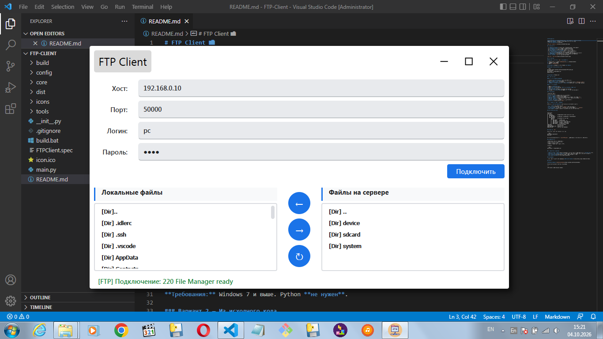
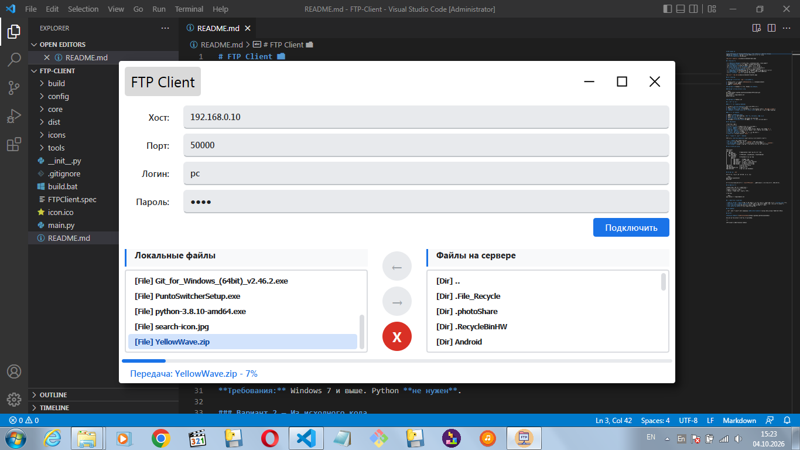

# FTP Client 📁

Лёгкий FTP-клиент для Windows/MacOS/Linux с двумя панелями и Material Design.
Написан на **PyQt5**, работает с любым FTP-сервером (в том числе
с **CX File Explorer** на Android).



## ✨ Возможности

- 🎨 **Material Design** — тёмные тени, скруглённые углы, синие акценты
- 🪟 **Frameless-окно** — своя шапка с кнопками управления
- 📂 **Две панели** — локальные файлы слева, сервер справа
- ⬇️ **Скачивание** и **⬆️ загрузка** файлов с прогресс-баром
- ⏹ **Отмена передачи** — в любой момент, с очисткой недокачанного
- ⚠️ **Подтверждение перезаписи** — не затрёт файл случайно
- 🔍 **Валидация** — IPv4/hostname, порт 1–65535, запрет недопустимых символов
- 💾 **QSettings** — сохранение хоста, порта и логина между запусками
- 📦 **Портативный `.exe`** — работает без Python



## 📦 Установка

### Вариант 1 — Готовый `.exe` (рекомендуется)

1. Скачай архив со страницы [**Releases**](../../releases/latest)
2. Распакуй в любую папку
3. Запусти `FTPClient.exe`

**Требования:** Windows 7 и выше. Python **не нужен**.

### Вариант 2 — Из исходного кода

```bash
git clone https://github.com/YaroslavIshkov/FTP-Client.git
cd FTP-Client
pip install -r requirements.txt
python main.py
```

**Требования:** Python 3.8+

## 🚀 Быстрый старт

### Со стороны телефона (Android)

1. Установи **CX File Explorer** (или любой FTP-сервер)
2. Включи **FTP-сервер** в приложении
3. **Запомни IP** и **порт** — показываются в приложении (обычно `192.168.x.x:2121`)
4. **Телефон и ноутбук должны быть в одной сети** (Wi-Fi или точка доступа телефона)

### Со стороны клиента

1. Запусти **FTPClient.exe**
2. Введи **хост** (IP телефона), **порт**, **логин**, **пароль**
3. Нажми **«Подключить»**
4. **Двойной клик** по файлу — скачивание или загрузка
5. Навигация — **двойной клик** по папке, **`..`** для возврата наверх

## ⌨️ Управление

| Действие | Как |
|----------|-----|
| **Подключиться** | кнопка «Подключить» или Enter |
| **Открыть папку** | двойной клик по папке |
| **Скачать файл** | двойной клик по файлу в правом списке, или кнопка `←` |
| **Загрузить файл** | двойной клик по файлу в левом списке, или кнопка `→` |
| **Обновить список** | кнопка `↻` |
| **Отменить передачу** | кнопка `X` во время передачи |
| **Наверх** | двойной клик по `[Dir] ..` |

## 🎯 Особенности работы с Android

FTP-сервер **CX File Explorer** имеет несколько неочевидных моментов:

- **Порт 2121** (не стандартный 21)
- **Корень** — виртуальный, обычно `/sdcard` (внутренняя память)
- **Права на запись** могут быть ограничены для системных папок (`/`, `/system`)
- **Кириллица** в именах — работает через UTF-8 (включено автоматически)

## 📁 Структура проекта

```
FTP-Client/
├── core/
│   ├── app/           # Application — центральный контроллер
│   ├── backend/
│   │   └── logic/     # FTPClient, LocalBrowser, TransferWorker
│   └── frontend/
│       ├── main/      # Frontend — сборка окна
│       ├── ui/
│       │   ├── header/    # Шапка окна
│       │   ├── input/     # Форма подключения
│       │   ├── filelist/  # Панель с двумя списками
│       │   ├── dialogs/   # Диалоги (overwrite)
│       │   └── styles/    # styles.py — все QSS
├── icons/             # Иконки интерфейса
├── main.py            # Точка входа
├── requirements.txt   # Зависимости
└── build.bat          # Сборка .exe (Windows)
```

## 🔧 Сборка `.exe`

Если хочешь собрать портативную версию сам:

```bash
pip install pyinstaller
build.bat
```

Готовое приложение появится в `dist/FTPClient/`. Папку целиком можно переносить куда угодно.

## 📚 Зависимости

| Библиотека | Версия | Назначение |
|-----------|--------|-----------|
| PyQt5 | 5.15.11+ | GUI |
| ftplib | стандартная | Работа с FTP |

Установка:

```bash
pip install -r requirements.txt
```

## ⚠️ Известные ограничения

- **FTP не шифрует трафик** — пароль передаётся открытым текстом. Используй только в **локальной** сети.
- **Активный режим не поддерживается** — используется пассивный (PASV), как в большинстве клиентов.
- **Нет докачки** — если передача прервалась, файл начинается с нуля.
- **Нет поддержки SFTP** — только классический FTP.

## 📄 Лицензия

Проект распространяется под лицензией **GPL-3.0-or-later** — из-за использования PyQt5 под GPLv3.

## 👤 Автор

**Yaroslav Ishkov** — [@YaroslavIshkov](https://github.com/YaroslavIshkov)

Если проект пригодился — поставь ⭐ на GitHub.

---

*FTP Client © 2026 Yaroslav Ishkov*